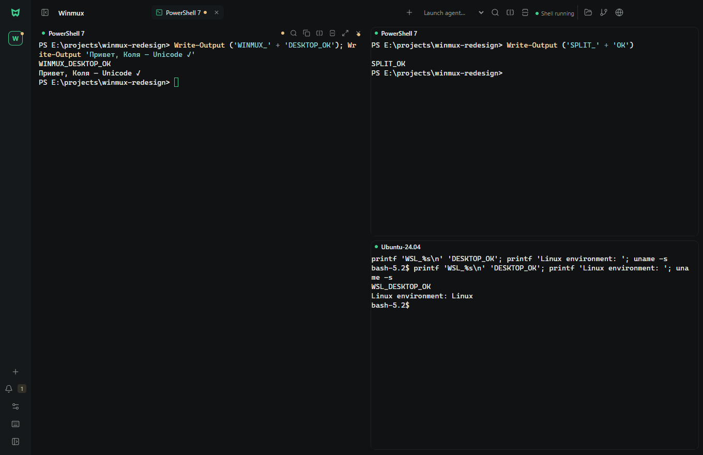
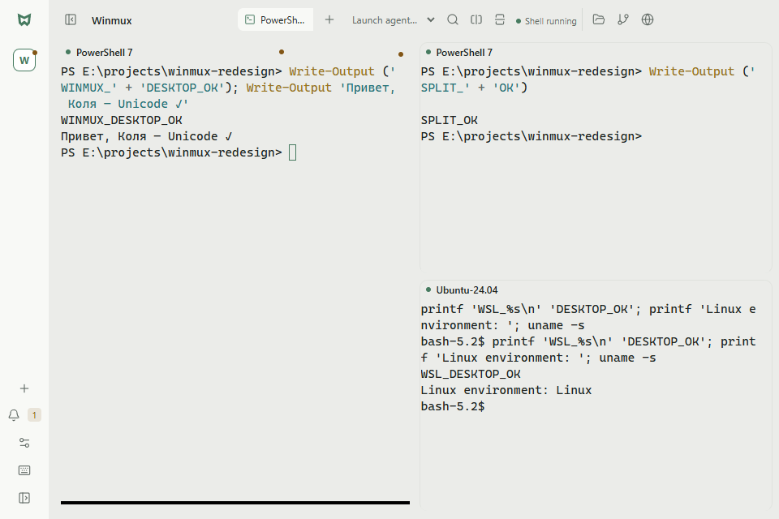
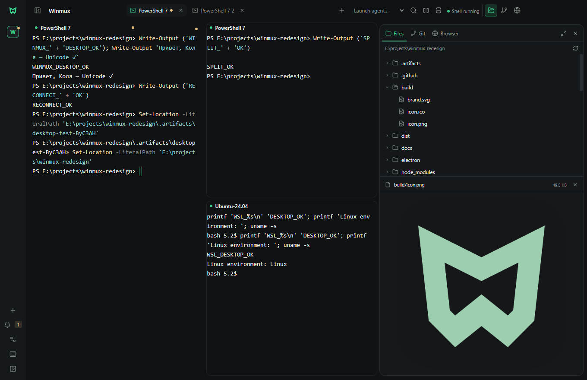
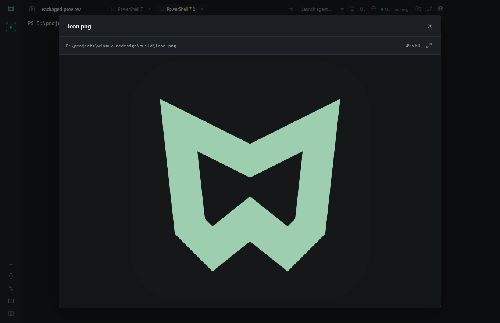
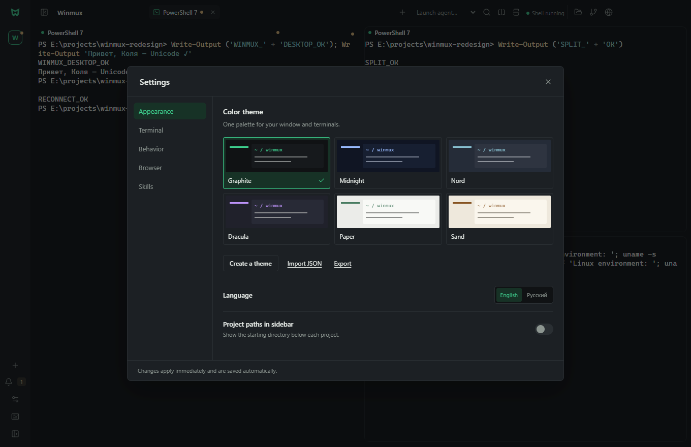
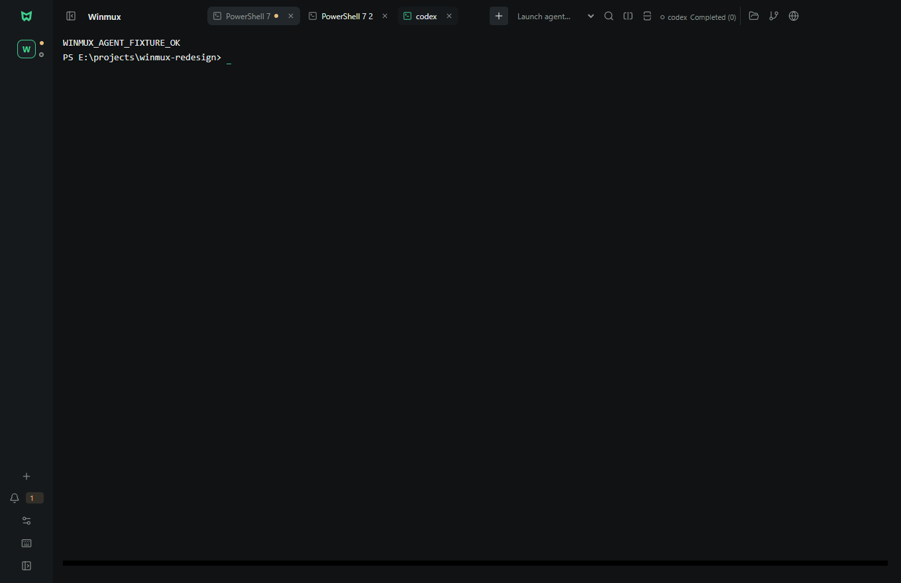

# Winmux

For developers who live with AI agents, 24/7 on Windows.

Keep your agents, shells, project files, Git changes, and browser previews in one Windows workspace. Winmux is an independent terminal multiplexer inspired by [cmux](https://cmux.com), built with Electron, TypeScript, xterm.js, and ConPTY.

This source tree prepares **0.2.0**, a dark workspace redesign for the existing Windows terminal workspace. The interface supports English and Russian, and all earlier workspace, terminal, process, project-tool, browser, hook, and file-preview capabilities remain available. See [verification notes](docs/verification.md) for recorded runtime evidence and the limits of agent integration.



## What is here

- Project workspaces with independent terminal tabs, Windows or WSL shell profiles, split terminals, adjustable dividers, and keyboard navigation.
- Background terminal sessions that keep running when you close the window and reconnect when you reopen it.
- Copy on selection, clipboard shortcuts, terminal search, terminal preferences, six themes, and custom theme import/export.
- Launch installed CLI agents in the current workspace, with agent identity and event-based status.
- Notifications linked to the workspace and terminal that need attention.
- Read-only project files and Git views that follow the active terminal directory, including text/image previews and staged or working-tree diffs.
- A tabbed HTTP(S) browser with independent pages, domain-scoped cookie import, and local automation for inspecting, clicking, filling, evaluating JavaScript, and screenshots.
- A local terminal CLI and [repository-shipped agent skills](docs/agents.md).

## Workspace layout

Projects live in a compact 60-pixel workspace rail. The rail keeps every workspace one click away and uses unread markers plus confirmed agent state without taking terminal space. Use the **Show workspace names** button at the bottom of the rail to expand it to 240 pixels; the expanded list can be resized with the pointer or keyboard, and the same button collapses it again.

The project switcher in the top header opens the current workspace list directly. The unified header also contains terminal tabs, new-tab and agent-launch controls, the active shell or agent state, and the Files, Git, and Browser tools. The former separate tab strip and status footer are gone, while the inspector still opens beside the terminals when needed.



## Download

Use the [latest release page](https://github.com/samo33ddd/winmux/releases/latest) for published Windows builds. When the 0.2.0 release is available, its generated Windows x64 assets will be:

| Asset | Purpose |
| --- | --- |
| `Winmux-Setup-0.2.0-x64.exe` | Windows x64 installer |
| `Winmux-Portable-0.2.0-x64.exe` | Windows x64 portable executable |

A version is available only when its assets appear on the release page. These expected names do not establish publication. Portable describes how the app is launched; local state still defaults to `%LOCALAPPDATA%/Winmux/`.

## Run from source

Requirements: Windows 10/11, Node.js 22.12+ (Node 24 recommended), and PowerShell (PowerShell 7 recommended). Install your AI CLI tools separately. WSL is optional and requires an installed, initialized distribution; WSL project tools also need `python3` and Git inside that distribution. Windows Git views require Git on the Windows PATH.

```powershell
npm ci
npm run build
npm start
```

After building, you can also double-click `Winmux.cmd`. Use `npm run dev` for renderer development. `npm run package` builds an unpacked application under `release/`; it is not the versioned installer release process.

## Daily use

Create a workspace with **Ctrl+Shift+N**, choose a shell profile, and select its startup directory. Select projects from the workspace rail or the header's project switcher. Terminal tabs in the unified header belong to the selected project. Use **Ctrl+T** or the header plus button to add a terminal that inherits the active terminal's directory. The agent selector opens an agent in another tab of that same workspace. Split terminals with the pane toolbar or shortcuts, drag a divider to resize, and double-click a divider to make its sides equal.

Use the folder, branch, and globe buttons in the top bar to open **Files**, **Git**, and **Browser**. Files shows text and image previews. Git shows the current branch, changed files, and diffs; perform edits, staging, commits, and other Git operations in a terminal. Browser opens a website or a local development server alongside your terminals.

Click local paths printed in a terminal to open the same text or image preview inside Winmux. Windows absolute paths, `./` relative paths, quoted paths with spaces, `file:line` references, and local `file://` links are supported. HTTP(S) links keep their existing external-browser behavior. Winmux never changes Windows file associations or executes the selected file.





Select terminal text to copy it, or use the copy and paste shortcuts below. **Ctrl+C** still interrupts a terminal process. Open Settings with **Ctrl+,** for language, themes, fonts, cursor, clipboard behavior, cookie import, and project-scoped skill installation. The bell opens notifications; choosing one focuses its terminal and tab.



Press **Alt** to show the application menu. In its **Winmux** submenu, **Close window** keeps terminal sessions running; **Stop all sessions and exit** asks for confirmation. **View** contains fullscreen and developer tools; **Help** opens the shortcut reference.

| Shortcut | Action |
| --- | --- |
| Ctrl+Shift+N | New workspace |
| Ctrl+T | New terminal tab in the current workspace |
| Ctrl+Tab / Ctrl+Shift+Tab | Next / previous terminal tab |
| Ctrl+Shift+D | Split to the right |
| Ctrl+Shift+E | Split below |
| Ctrl+Shift+W | Close the focused pane |
| Ctrl+Shift+F | Search terminal output |
| Ctrl+Shift+Enter | Zoom pane / restore layout |
| Alt+arrow | Move pane focus |
| Ctrl+Shift+C / V | Copy / paste |
| Ctrl+Shift+U | Jump to the newest unread notification with an open pane |
| Ctrl+, | Settings |
| Alt | Show application menu |

## Sessions and preview limits

Closing the window detaches the UI from the background terminal daemon. Closing a pane or workspace stops its terminal processes. The explicit stop-all action stops the daemon and every terminal it owns.

A daemon restart or Windows reboot restores saved layout and metadata with **fresh shells**. It cannot preserve running processes or resume agent conversations, and it never replays previous commands. The process indicator reports whether a shell is running; it does not infer whether an agent is thinking, waiting for approval, or finished.

The unified header and selected workspace item show the agent and its last confirmed state; the collapsed rail uses a smaller state marker for the same event-derived information. **Agent status hooks** adds session-only hooks for supported Claude Code and modern Codex launches, reporting work, permission/input waits, and completed turns. Existing global/project configuration and Codex notification commands remain intact. Windows session hooks require PowerShell 7.3 or later; older agent versions may not support the hook options. Agents without a supported hook adapter show unknown activity until the shell confirms their exit, rather than guessing from output or silence. Commands typed manually in a shell are not automatically classified as agents.



Files and Git follow the active terminal's directory through shell integration. PowerShell keeps the user's profile and prompt; WSL Bash reports its directory through OSC 7. While a foreground program is running, the displayed directory is the last directory reported by its shell. Windows and Linux paths are separate namespaces: the folder picker selects Windows directories; enter Linux paths for WSL profiles.

The in-app explicit file preview is separate from the containment-limited Files panel. Text is read up to 512 KB and supported raster/SVG images up to 12 MB; binary files show metadata only. Relative terminal or CLI paths resolve from the caller pane's live directory. WSL previews use `python3` inside the pane's distribution. UNC paths, remote `file://` hosts, directories, and oversized images are rejected.

Browser automation is available only while the desktop window is open. The embedded browser is a preview surface: popups, downloads, and permission requests are blocked. Its tabs retain independent pages and share a persistent browser session. File and Git views are read-only. Conversation resume, MCP, and automatic worktree creation remain future work.

After an application update, an already-running daemon continues using its loaded code. Winmux detects older daemons and explains which features require a restart. When ready to stop your running commands, use **Stop all sessions and exit**, then reopen Winmux. Merely closing the window or reloading the UI does not upgrade a daemon. Never stop shared sessions as part of automated test cleanup.

## Local automation

From a source checkout, start the desktop with `npm start`, or start only the terminal daemon with `npm run cli -- start`. Then inspect the available commands:

```powershell
npm run cli -- --help
npm run cli -- list
npm run cli -- environment
npm run cli -- open ./screenshot.png --pane PANE_ID
npm run browser -- --help
```

`open` requires the matching desktop window and uses its authenticated local UI pipe. `PANE_ID` may be replaced by `WINMUX_PANE_ID`; `--workspace WORKSPACE_ID` is the fallback when no pane is supplied. These commands run from a source checkout and do not install a global `winmux` executable. Read [the agent guide](docs/agents.md) for exact JSON arguments and practical workflows, or [the daemon contract](electron/backend/README.md) for protocol details.

Local state and capability tokens stay under `%LOCALAPPDATA%/Winmux/`; set `WINMUX_DATA_DIR` consistently for the UI and both CLIs to select an isolated instance. API access can send input to real shells and act on signed-in pages. Keep tokens, terminal output, browser captures, and private project data out of commits and public reports.

## Contributing

Changes go through pull requests, code review, and green CI before merge. See [CONTRIBUTING.md](CONTRIBUTING.md) for setup, meaningful verification, and the versioned release workflow.

```powershell
npm run build
npm run test:backend
npm run test:workspace
npm run test:file-preview
npm run test:desktop
```

The smoke checks exercise real processes and desktop windows. WSL coverage requires a usable distribution; a skipped environment is not a verified environment. Test artifacts belong in ignored `.artifacts/`.

See the [product direction](docs/ideas/winmux.md) and [changelog](CHANGELOG.md) for scope. Winmux has no affiliation with cmux and bundles no model subscriptions or API keys.
