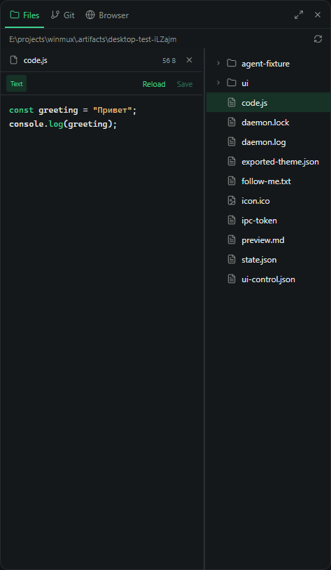
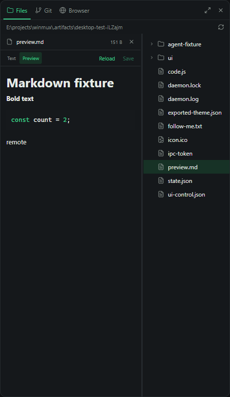
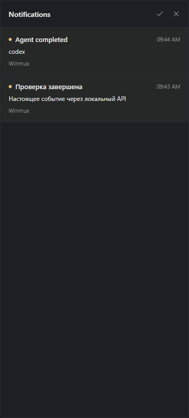

# Winmux 0.2.2 verification

The candidate is tested on Windows x64, Node.js 24.12.0, Electron 45.3.2, PowerShell 7 and WSL Ubuntu-24.04. All daemon, shell, browser, skill installation and file-writing fixtures use disposable directories and authenticated pipes. The owner's running daemon and terminals are retained.

## Automated checks

| Check | Observed result |
| --- | --- |
| `npm run build` | TypeScript and Vite production build pass. Vite reports the existing large-bundle advisory. |
| `npm run test:backend` | Pass: actual PowerShell/WSL PTYs, authentication, bounds, CLI input, snapshots, reconnect, notifications, restoration and shutdown. |
| `npm run test:workspace` | Pass on Windows and Ubuntu: full UTF-8 save/read, stale-content conflict, traversal and size rejection, invalid UTF-8/binary/image refusal; draft save/remount/closed-owner regression passes. |
| `npm run test:cwd-agent` | Pass on PowerShell and Ubuntu for Claude/Codex executable fixtures: real authenticated hook helpers, completion, duplicate Stop suppression, another completed turn, failure, correct pane/workspace and shell survival. |
| `npm run test:profile` | Pass: actual PowerShell profile/prompt and LASTEXITCODE preservation. |
| `npm run test:skills` | 13 pass, zero skipped: Windows installation/conflicts/junctions, unavailable-profile refusal, Ubuntu installation/Windows Node interop/conflicts, installed-client connection and Settings contract. |
| `npm run test:integrations` | 116 pass, zero skipped, followed by successful native Codex controller, agent controller and title-mode smoke tests. |
| `npm run test:cookies` | Pass: normalization and domain/security constraints. |
| `npm run test:file-preview` | Pass: six parser checks, Windows/Ubuntu readers and real Electron automatic-open/error/recovery regression. |
| `npm run test:desktop` | Pass: real Electron shell/tab/browser flows, six themes and EN/RU, file save/wrap/left placement, Markdown and source tokens, unsafe markup refusal, installed-client operations, recovery and activity presentation. The final targeted desktop repetition also checks external file changes after a clean save and the actual completion notification panel. |
| `node --test tests/release-workflow-regression.cjs` | 10 pass, zero skipped: release artifact placement, draft visibility, bounded retries and malformed/foreign release rejection. |
| `npm audit --omit=dev` | Zero production dependency vulnerabilities reported. |

The first integration run exposed an obsolete literal version assertion (`0.2.1`); the assertion now compares the advertised client version with package.json, and the suite passes for 0.2.2. The first editor desktop experiment changed a fixture later reused by a CLI check; restoring the fixture after the save assertion fixed that test interaction.

## Runtime evidence

The desktop test uses the real preload/main-process services. It saves long wrapped text and verifies disk bytes, retains an unsaved draft across file switches, reloads it after confirmation, opens source code with highlighted tokens, renders Markdown, and rejects script/image execution. The file preview is measured to be left of the tree. A short project name no longer reserves a wide header slot.

Both bundled skills are installed into a disposable project. Their installed wrappers perform terminal `list`, `send` and `read --json` against an actual PowerShell session, then browser `open`, `snapshot`, `fill`, `click`, `evaluate` and `screenshot` against a local HTTP fixture. The screen contains `SKILL_TERMINAL_OK`; the page result contains `SKILL_BROWSER_OK`. This verifies client behavior, not whether a third-party agent automatically chooses the skill.

The screenshots contain only disposable fixture content. Names such as ipc-token and ui-control.json are directory entries; their contents are neither opened nor published.

## Independent review

A native reviewer was requested on the live `codex/gpt-6.1-sol` route with supported `high` effort. The tool returns an agent/session ID but does not expose resolved child model metadata. Review found and verified repairs for three draft defects: an old save response erasing a newer draft, orphan drafts blocking window closure after owner deletion, and a clean cache hiding a later external disk change. Repair verification reports no remaining blocker in that reviewed scope. The parent runs the actual Electron/WSL checks; the reviewer does not claim to have repeated those runtime suites.

## Limits

- Complete valid UTF-8 text is editable up to 512 KiB. Image/binary/truncated/invalid UTF-8 files are not editable. Save conflict detection compares the current content before writing; it does not coordinate with arbitrary external applications through a shared filesystem lock.
- Drafts live in renderer memory. Forced process termination can lose unsaved work; normal window closure warns, owner closure explicitly warns about discarding it, and an in-progress save blocks owner closure in the UI.
- Markdown links/images are represented as text; raw HTML and remote image loading are disabled. Common grammars plus PowerShell are supported; unknown source languages remain plain text.
- An unavailable native connection or missing hook cannot prove agent activity or completion. Notifications require a confirmed lifecycle or launch-exit signal. Existing sessions keep their old daemon until the owner finishes them and restarts with the updated backend.
- The owner confirmed that Issue #13 no longer recurs after 0.2.1. It is closed as no longer reproducible, with the historical diagnosis explicitly unresolved. The current regression proves that output, hover, scroll, selection, resize and snapshot reattach do not open files, and missing-file errors recover in EN/RU. No available historical record establishes the initiating request from the original screenshot.
- CI, merge, tag and published download/checksum verification are separate release gates; this local record alone does not establish publication.
