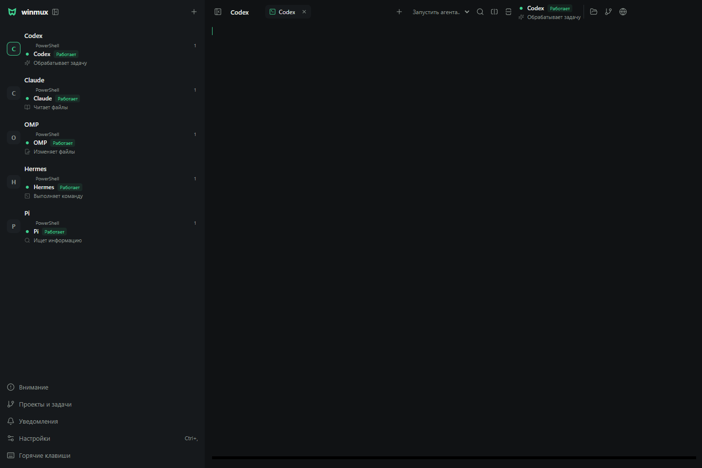
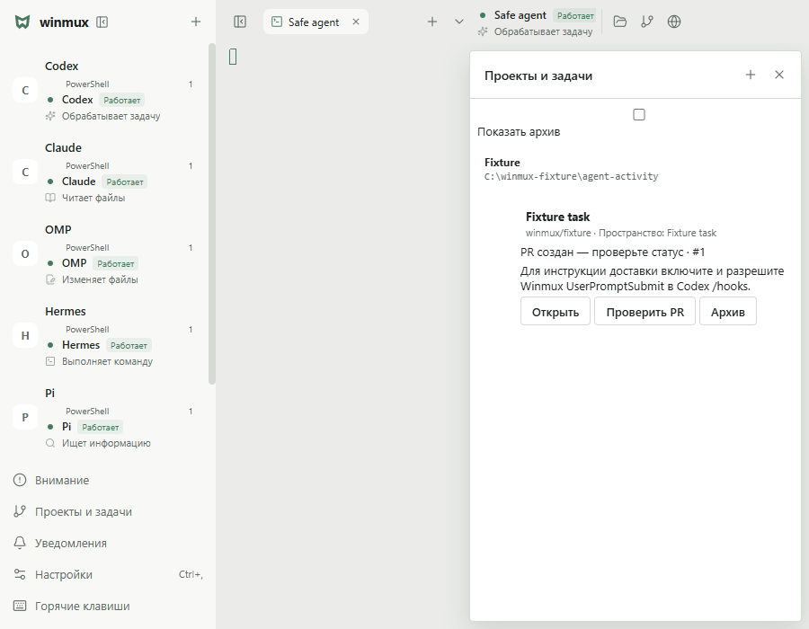

# Winmux 0.2.3 verification

This record covers the local 0.2.3 candidate on Windows 11 x64, Node.js 24.12.0,
Electron 45.3.2, PowerShell 7, Git, and WSL Ubuntu-24.04. It distinguishes local
source/runtime checks from current-head GitHub CI, tagging and published assets.
The owner desktop and shared Codex daemon were not stopped by these checks.

## Local checks

The complete CONTRIBUTING sequence passed:

| Command | Observed coverage |
| --- | --- |
| `npm run build` | TypeScript and production renderer |
| `npm run test:backend` | Real Windows/WSL PTYs, input, snapshots, persistence, task-review RPC and restart retention |
| `npm run test:workspace` | Files, drafts, task worktree ownership/recovery, task state, PR gates and attention grouping |
| `npm run test:cwd-agent` | Real cwd, agent launch and Windows/WSL hook context |
| `npm run test:profile` | PowerShell profile behavior |
| `npm run test:skills` | 13/13, including real Windows installed wrappers and Ubuntu-24.04 Windows-Node interop |
| `npm run test:integrations` | Agent adapters, native Codex transport/mapping/activity, hooks, input and lifecycle |
| `npm run test:cookies` | Domain-scoped cookie import |
| `npm run test:file-preview` | Local links, containment and real Electron preview/link routing |
| `npm run test:desktop` | Complete six-fixture Electron sequence, installed terminal/browser operations, recovery and actual renderer captures |
| `node --test tests/release-workflow-regression.cjs` | 10/10 release publisher regressions |

After the independent review repair, the focused delivery/state/instruction suite
passed 12/12. The optional installed Windows Codex 0.169.0 app-server test also
passed 1/1: a disposable home trusted only fixture handlers and captured bounded
task context over local HTTP without model inference or an unsolicited turn.

An initial skills attempt inherited the owner pipe name and failed with
`EADDRINUSE`; a child environment isolated from those overrides passed. The new
backend Git fixture initially left read-only loose objects during cleanup. The
repair clears the attribute only in that fixture's object directory, and the
complete backend check passed with `BACKEND_SMOKE_OK`. The first desktop
aggregate exceeded the caller's 300-second timeout after its earlier components
passed. A complete rerun with an adequate outer deadline exited successfully;
component results alone were not treated as the full desktop gate.

## Agent status and native dragging

The same `AgentStatus` component serves the terminal header and expanded
workspace list. Actual Electron checks cover aligned icon/text columns, English
and Russian, all six themes, and 900px. Confirmed running without a tool event
shows generic task processing; a later tool event replaces it. Unknown, waiting
and ended states do not expose stale action captions or previous-launch codes.
These screenshots use disposable daemon fixtures, not signed-in agent output.

The standalone `cua-driver` supplied real native pointer drags in a separate
Winmux window. Window-manager origins changed with one tab, two tabs and a
900px restored window; dragging a maximized window restored and moved it.
[The detailed follow-up](verification-reported-bugs.md#023-native-window-drag-follow-up)
records exact geometry and the distinction between gesture delivery and measured
OS movement. Programmatic sizing only prepared the cases.

## Review and delivery

Independent native Sol review found a formal-review edge case:
`CHANGES_REQUESTED` followed by informational `COMMENTED` incorrectly cleared
the blocker. The new merge regression reproduced it before the repair and
passed afterward. Informational comments now preserve the last decisive review;
actual approval or dismissal can resolve it. A separate documentation pass
corrected obsolete README link and worktree statements. The findings were
independently checked as closed before integration.

An isolated real daemon attached the release worktree as a ready project task,
reported hook delivery support and returned the correct delivery context. Before
a PR existed, refresh returned `NOT_FOUND`. An installed terminal wrapper invoked
the new review RPC from an unrelated directory. A deliberate blocking fixture
record survived an isolated daemon restart; it was not presented as approval.
Final approval must follow the independent review of the actual committed head.

The owner selected native Codex review rather than a separate human GitHub
reviewer. Main protection was backed up before changing the GitHub approval
count from one to zero. Readback retained strict required `windows` checks from
GitHub Actions App 15368 and disabled force pushes/deletions. The product still
requires exact-head independent review evidence, honors requested changes and
repository-imposed review requirements, and merges without admin bypass.

## Portable recovery, skills and limits

The original live portable extraction lacked ICU and two V8 snapshot files.
Its executable matched the intact unpacked package byte-for-byte. Restoring only
those missing resources, checking their hashes and waiting for a synchronous
Node-mode probe recovered startup. Subsequent real Codex hooks updated the
original running pane without a synthetic status or owner restart. The cause of
the missing files remains unknown; this evidence supports runtime recovery,
not a speculative launcher rewrite.

The newly packaged 0.2.3 unpacked runtime separately reported the expected
version and Electron 45.3.2 with all three resources present and empty stderr.
This does not by itself establish installer publication or an owner upgrade.

All three skills were reviewed. `winmux-dev` documents native drag verification,
portable recovery, shared status presentation and exact-commit local review.
`winmux-terminal` documents the review command, limits, trust boundary and generic
activity caption. `winmux-browser` needs no operation change; its version tracks
0.2.3 and its installed-wrapper desktop coverage remains required. Existing UI
metadata stays English. Frontmatter and existing UI YAML were parsed with
`js-yaml`; the optional Python validator lacked PyYAML.

Codex hook trust remains explicit and per-launch commands may need renewed trust.
WSL bridge/worktree coverage does not imply a verified native Linux Codex
inference session. Hosted Windows CI has no WSL distribution and cannot replace
the local Ubuntu evidence. Running owner daemons retain their loaded version;
closing only the window does not upgrade them or resume conversations.
