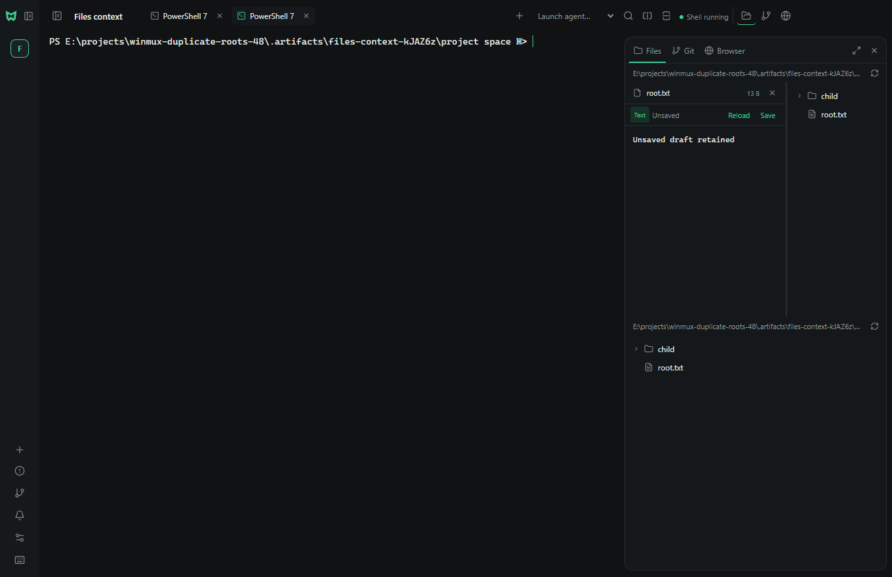
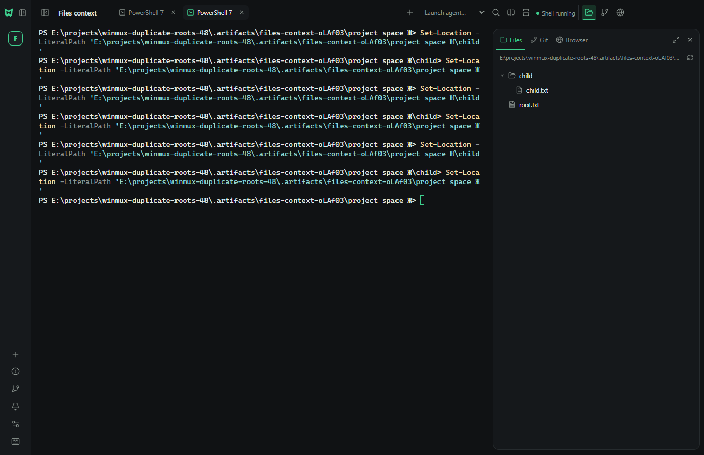

# Files sidebar context identity (#48)

The user reported several identical directory roots stacked in one Files sidebar.
`WorkspaceTools` gave its sibling Files and Git panels the same context key.
After both tools had been visited, changing terminal context could leave an orphaned
Files subtree in the DOM. The isolated Electron regression reproduced two roots
where one was expected on the first same-directory terminal-tab switch.

The repair prefixes each key with its tool identity. Workspace, pane and cwd still
trigger filesystem-view remounts, invalidating old requests. Shared file draft keys
and the browser component's stable identity are unchanged.

## Runtime evidence

`node tests/files-panel-context-electron.cjs` failed against the original compiled
renderer (`2 !== 1` roots) and passed after rebuilding with the repair. The test
uses real Electron, preload/IPC, filesystem reads, PowerShell terminals and a
loopback browser guest in an isolated data directory. It visits Files/Git/Browser,
repeats same-directory pane switches and live directory changes three times, and
checks total and visible root counts, exact current pane/cwd, a retained unsaved
draft, unchanged disk content, nested directory expansion and retained browser
form state. The regression runs first in `npm run test:desktop`.

The owner explicitly cancelled application restart. No owner window, terminal,
Winmux daemon or shared Codex daemon was restarted for this repair. Orca was not
used. Passing source tests does not mean the running portable application has
loaded this change.

## Skill review

Reviewed all three skills. Updated `winmux-dev` with the sibling-key/remount,
draft/browser ownership and exact regression contracts. Its English UI metadata
needs no change. `winmux-terminal` and `winmux-browser` require no changes: neither
CLI surface, installation nor operation contract changes. Skill installation and
wrapper checks remain required through `npm run test:skills` and the desktop suite.
