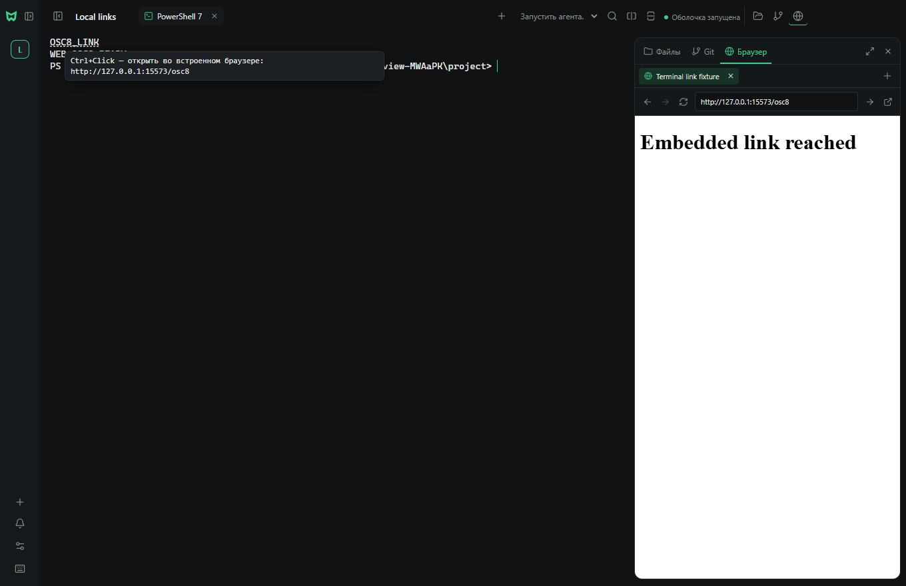

# Reported bug repairs: verification

Verified on Windows with Electron 45.3.2, Node 24, PowerShell 7 and Ubuntu-24.04.
All task-created terminals, browser guests, fixtures and capability files used
isolated data directories. The owner's Winmux instance was not restarted.

## Results

| Check | Observed result |
| --- | --- |
| `npm run build` | TypeScript and Vite passed. Existing large-chunk warning remains. |
| `npm run test:backend` | Real ConPTY/WSL passed: NUL console event, SOH, relocation with stable IDs/PIDs/output, invalid moves, saved-size recovery, fresh shells and later exit. |
| `npm run test:workspace` | Windows junction and WSL symlink containment, untracked nested files and existing file/Git scenarios passed. |
| `npm run test:cwd-agent` | Windows and Ubuntu-24.04 launch/hook argv, authenticated lifecycle, stale rejection, shell return and recovery passed. |
| `npm run test:profile` | PowerShell profile scenarios passed. |
| `npm run test:skills` | 13/13 passed, including actual WSL Windows-Node wrapper interop. |
| `npm run test:integrations` | 124/124 passed, followed by Codex controller, agent controller and title-mode smoke checks. |
| `npm run test:cookies` | Cookie import scenarios passed. |
| `npm run test:file-preview` | Local preview suite passed; ordinary and OSC 8 HTTP Ctrl+Click loaded the owning embedded browser, with zero external-browser calls. |
| Desktop suite components | `desktop-smoke`, `agent-integrations-electron`, `recovery-electron`, `deferred-agent-launch` and `agent-activity-electron` passed. |
| `node --test tests/release-workflow-regression.cjs` | 10/10 passed; no release was published. |

Desktop verification included real pointer drag from a pane header and from a
terminal tab through another tab into a split, visible drop targets, preserved
processes/output, Unicode clipboard input over 64 KiB, Ctrl+Space, six themes,
English/Russian, file editing and installed terminal/browser wrappers. The
installed terminal wrapper also relocated an existing pane across tabs with
`rpc pane.move`. Installed browser wrappers exercised open, snapshot, fill, click,
evaluate and screenshot against a loopback fixture.

## Real Codex lifecycle

A separate real Codex 0.169.0 pane launched with seven session hooks. Its actual
hook review screen showed the generated session commands. After inspecting and
trusting those commands through that screen, one harmless no-tools request
returned `WINMUX_REAL_HOOK_OK`. With native-controller discovery disabled in the
fixture, authenticated hooks reported `idle`, `running`, then `completed`; a new
`Agent completed` notification was present. No owner prompt, model/provider change
or hook-trust bypass was used. Exiting returned to the PowerShell prompt.

Independent native reviewer R1 ran on `codex/gpt-6.1-sol`, effort `high`, confirmed
in persisted child metadata. It found an artifact cleanup leak and stale activity
after native failure. Both were repaired and independently rechecked: actual
ConPTY disposal removed both launch files, and the activity/mapping regressions
passed 28/28. No unresolved confirmed code findings remained.

## Skills and limitations

Reviewed and updated all three canonical skills: `winmux-terminal` documents input,
relocation and embedded-link behavior; `winmux-browser` documents terminal link
routing; `winmux-dev` documents hook context, command-line budgets, recovery and
verification boundaries. English UI metadata needed no change. The reviewed
contributor skill was backed up, copied to the installed `.agents` location and
both files matched SHA-256. Product-installed wrappers were verified separately.

Native whole-window movement remains unverified: both available native UI paths
reported an unavailable native pipe. Electron computed styles confirmed blank
tab-strip space is `drag` and interactive buttons remain `no-drag`, but this does
not establish actual OS window movement. Keep #34 open for that acceptance step.

Some exploratory desktop attempts failed on fixture readiness/layout assumptions;
those waits and layout isolation were corrected. One attempt ended with a caught
UI banner and unavailable fixture daemon during teardown; a subsequent complete
desktop run passed without another product change. Hosted current-head CI is an
additional merge gate. Hosted Windows has no WSL distro and cannot replace the
local Ubuntu-24.04 evidence. No installer/package/release or owner restart is
claimed by these source checks.
